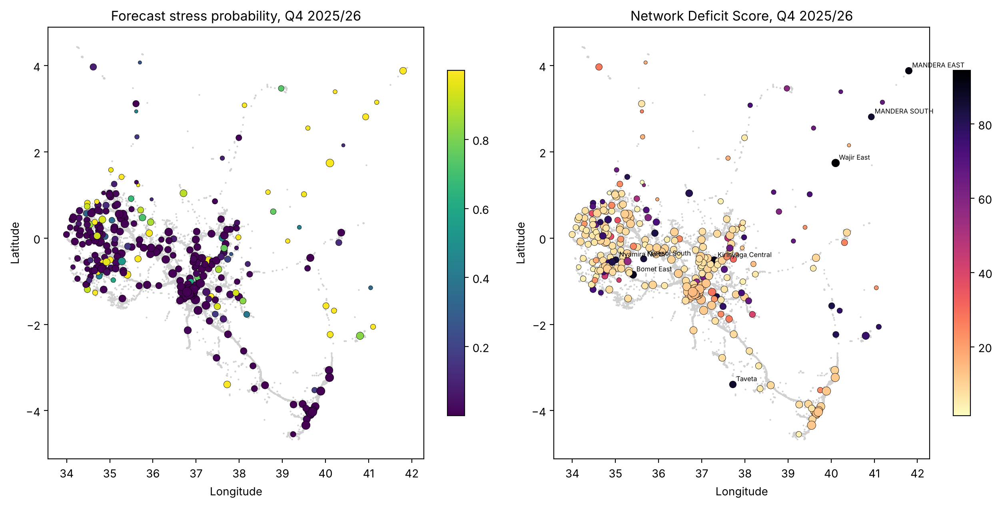
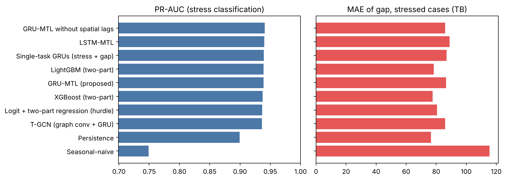
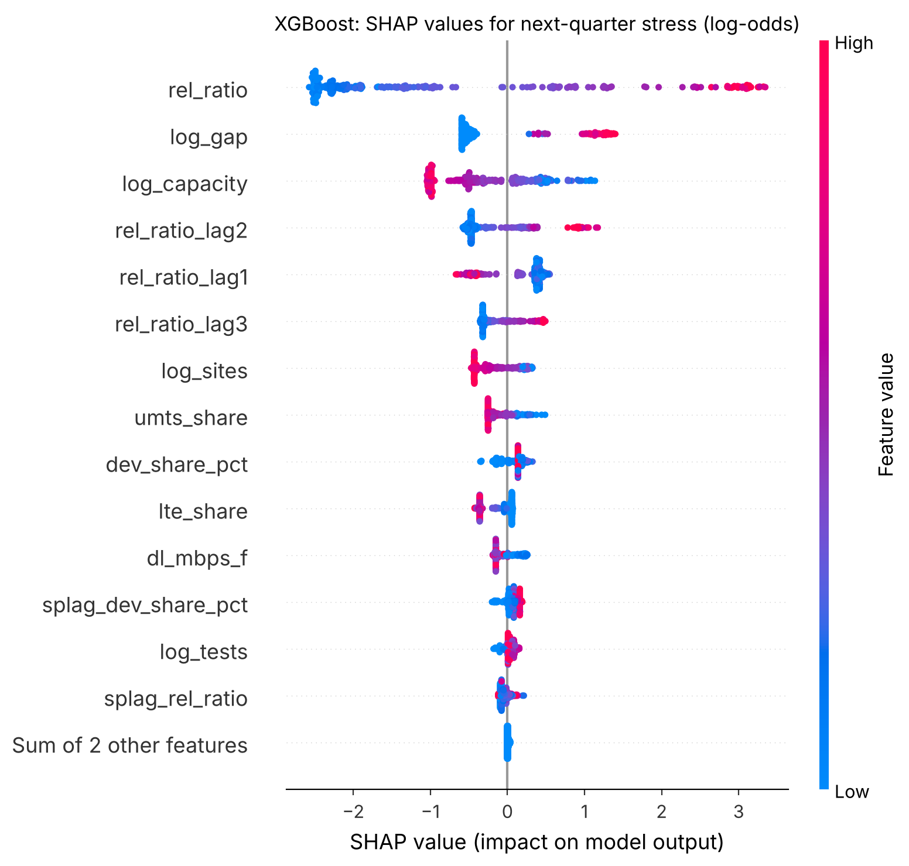

# Forecasting mobile network stress in Kenya with explainable multi-task learning

Where will Kenya's mobile network run short of capacity next quarter, and why? This project builds a sub-county level panel of mobile data demand and network capacity from open data, forecasts which of Kenya's 294 sub-counties will be under capacity stress one quarter ahead, explains the forecasts with SHAP, and ranks sub-counties for upgrade assessment with a Network Deficit Score (NDS).

It was my applied research project (*Explainable Multi-Task Learning for 5G Spatio-Temporal Traffic Forecasting in Kenya*), and the five notebooks here are the full, reproducible analysis pipeline.



## Highlights

- **Built a 294 sub-county × 17 quarter panel (Q1 2022 to Q1 2026)** from three open sources: 78,722 OpenCellID cells clustered into 40,724 approximate sites, 80,517 Ookla speed-test tiles, and the Communications Authority of Kenya's national data-traffic series.
- **Compared 10 forecasting models** on the last four quarters: a GRU multi-task model (the proposed model), LSTM and T-GCN variants, single-task GRUs, XGBoost, LightGBM, a hurdle regression, and naive baselines. Every learned model reached ROC-AUC ≈ 0.98 against 0.955 for persistence.
- **Tested the hypotheses formally** (DeLong tests, county-clustered bootstrap, Diebold–Mariano). The multi-task GRU was *not* significantly better than XGBoost or single-task GRUs, and spatial information did not help. I report that result as it is.
- **Checked generalisation and uncertainty:** forecasts held up with whole counties held out (ROC-AUC 0.981), and split-conformal intervals hit 90.3% coverage against a 90% target.
- **Turned forecasts into a decision tool:** the NDS combines stress probability, expected capacity gap and user exposure. Its top 10% was stable across 7 of 7 weighting and model variants (overlap ≥ 0.70).

## Approach

```
01 Spatial canvas ──────────┐  OpenCellID cells → approximate sites (supply side)
                            ├─► 03 Spatial downscale ─► 04 Forecasting engine ─► 05 Explainability & NDS
02 Temporal extraction ─────┘  CA national series + Ookla tiles (demand side)
```

| Notebook | What it does |
|---|---|
| [`01_spatial_canvas`](01_spatial_canvas.ipynb) | Cleans the OpenCellID registry (GSM, UMTS, LTE), maps operators, and groups co-located cells into sites with complete-linkage clustering (no two cells of a site more than 100 m apart). |
| [`02_temporal_extraction`](02_temporal_extraction.ipynb) | Prepares the 17-quarter national traffic series (imputing three missing quarters) and cleans the Ookla tiles. |
| [`03_spatial_downscale`](03_spatial_downscale.ipynb) | Distributes national traffic to sub-counties in a mass-preserving way, weighted by time-varying Ookla device counts, and compares it with a capacity proxy built from the cell mix. A sub-county is labelled *stressed* when its load-to-capacity ratio is in the top 20% that quarter. |
| [`04_mtl_engine`](04_mtl_engine.ipynb) | Trains and tunes the models with rolling-origin validation and 5 seeds, then evaluates them on the held-out quarters with formal tests, county holdout, performance by stratum and conformal intervals. |
| [`05_explainability_nds`](05_explainability_nds.ipynb) | Explains the forecasts with SHAP (global, by feature family, and for individual sub-counties), builds the NDS, tests its robustness, and produces the priority and watch lists. |

The multi-task model is a GRU with two heads that share one encoder: one head classifies next-quarter stress, and the other estimates the capacity gap (traffic above capacity, in TB) if stress occurs.

## Key results

Test set: 294 sub-counties × 4 quarters (Q4 2024/25 to Q3 2025/26). Full table: [`T4.16_main_results.csv`](Outputs/tables/T4.16_main_results.csv).

| Model | ROC-AUC | PR-AUC | F1 | MAE of gap, stressed cases (TB) |
|---|---|---|---|---|
| GRU-MTL (proposed) | 0.982 | 0.939 | 0.840 | 86.6 |
| GRU-MTL without spatial lags | 0.982 | 0.941 | 0.842 | 85.9 |
| Single-task GRUs | 0.982 | 0.939 | 0.841 | 86.9 |
| XGBoost (two-part) | 0.981 | 0.938 | 0.839 | 77.6 |
| LightGBM (two-part) | 0.982 | 0.939 | 0.837 | 78.4 |
| T-GCN (graph conv + GRU) | 0.981 | 0.936 | 0.834 | 86.0 |
| Persistence | 0.955 | 0.900 | 0.835 | 76.5 |



**What this means.** Learned models clearly beat persistence at ranking which sub-counties will be stressed (PR-AUC 0.94 vs 0.90). The architectures are statistically indistinguishable from each other, so a well-tuned gradient-boosting model is as good as the multi-task GRU here. For the size of the gap, no model beat simply carrying the last quarter forward, which is honest evidence that this part of the problem is hard with quarterly data.

| Hypothesis | Verdict |
|---|---|
| H1: the multi-task GRU beats single-task GRUs and XGBoost | Not supported |
| H2: spatial information (spatial lags or graph convolution) improves forecasts | Not supported |
| H3: the multi-task GRU's residuals show no spatial autocorrelation | Partly supported |
| H4: the NDS top 10% is robust to weights and model choice | Supported |

### What drives the forecasts

The current and lagged stress ratio dominates (about 61% of total |SHAP| for the GRU, 70% for XGBoost), followed by the capacity proxy and technology mix. Ookla test volume, recorded sites and neighbouring sub-counties' stress add smaller independent signals ([`T4.23`](Outputs/tables/T4.23_shap_families.csv)).



### Where to look first

The highest-scoring sub-counties for Q4 2025/26 are Wajir East, Mandera East, Bomet East, Kirinyaga Central and Nyamira North, all with no LTE cells in the 2019 registry. The full list, with the SHAP drivers and a suggested screening action for each sub-county, is in [`T4.28_priority_list.csv`](Outputs/tables/T4.28_priority_list.csv). Sub-counties with too few speed tests to trust are kept apart in a [watch list](Outputs/tables/T4.29_watch_list.csv).

## Limitations

- **The demand side is an estimate.** Sub-county traffic is downscaled from a national total using Ookla device counts. The project shows that agreement with Ookla speeds comes from the capacity proxy, so speeds do not validate the demand allocation (Table 4.7).
- **The infrastructure snapshot is old.** OpenCellID coordinates are crowdsourced and the registry is a 2019 snapshot with no 5G cells, so the priority list is a screening tool for field verification, not an investment decision.
- **Short series.** 17 quarters limits how much any model can learn about temporal dynamics.

## Run it yourself

```bash
git clone <this-repo-url>
cd kenya-network-stress-forecasting
pip install -r requirements.txt      # Python 3.12+; results produced with Python 3.13
jupyter lab
```

Open the notebooks in order (01 → 05) and run each with **Restart Kernel and Run All Cells**. The whole chain takes about 9 minutes on a CPU; no GPU is needed. The notebooks are committed with their outputs, so you can read them on GitHub without running anything.

Notes:
- Versions are pinned because other XGBoost or SHAP versions change results in the 3rd to 4th decimal.
- macOS: run `brew install libomp` first (needed by XGBoost and LightGBM).
- Intel Macs cannot install the pinned PyTorch; run notebooks 04 to 05 elsewhere (for example Google Colab).

## Repository layout

```
├── 01_spatial_canvas.ipynb … 05_explainability_nds.ipynb
├── project_config.py          shared paths, constants, helpers and network classes
├── requirements.txt
├── Data/
│   ├── README.md              sources and licences
│   ├── raw_spatial/           OpenCellID extract
│   ├── raw_ookla/             Ookla Open Data tiles
│   └── processed/             CA national series (other files are generated)
└── Outputs/
    ├── tables/                32 result tables (T4.xx_*.csv)
    ├── figures/               15 figures (F4.xx_*.png)
    └── models/                trained GRU-MTL seeds, XGBoost models, scalers, forecasts
```

Table and figure numbers follow Chapter 4 of the project report.

## Tech stack

Python, pandas, NumPy, scikit-learn, PyTorch (GRU, LSTM, T-GCN), XGBoost, LightGBM, SHAP, statsmodels, SciPy, Matplotlib.

## Data and licence

Code: MIT ([LICENSE](LICENSE)). Data and derived outputs keep their source licences, including CC BY-NC-SA 4.0 for the Ookla data; see [`Data/README.md`](Data/README.md).

Speedtest® by Ookla® Global Fixed and Mobile Network Performance Maps. Based on analysis by Ookla of Speedtest Intelligence® data for Q1 2022 to Q1 2026. Provided by Ookla and accessed October 2026. Cell data © OpenCellID contributors, CC BY-SA 4.0.

## Author

**Nelson Nyamweya**: [LinkedIn](<your-linkedin-url>) · [GitHub](<your-github-url>)
